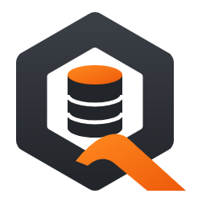

<p align="center">
  
</p>

<h1 align="center">Qubase</h1>

<p align="center">
  One app for every database: query, design and explore 22 databases with an AI assistant that writes in your editor.
</p>

<p align="center">
  <a href="https://github.com/afzalabdullah/Qubase/releases/latest"><b>Download for Windows</b></a> ·
  <a href="#features">Features</a> ·
  <a href="#supported-databases">Databases</a> ·
  <a href="#getting-started-for-developers">Build from source</a>
</p>

---

## Contents

1. [What is Qubase](#what-is-qubase)
2. [Download and install](#download-and-install)
3. [Features](#features)
4. [Supported databases](#supported-databases)
5. [AI assistant](#ai-assistant)
6. [Privacy and security](#privacy-and-security)
7. [Repository layout](#repository-layout)
8. [Getting started for developers](#getting-started-for-developers)
9. [Building the Windows installer](#building-the-windows-installer)
10. [Publishing a release](#publishing-a-release)
11. [Landing page](#landing-page)
12. [Adding a new database](#adding-a-new-database)
13. [Logs and troubleshooting](#logs-and-troubleshooting)
14. [Tech stack](#tech-stack)
15. [Roadmap](#roadmap)
16. [Author](#author)

---

## What is Qubase

Qubase is an application for working with databases. Instead of opening one tool for PostgreSQL, another for MongoDB and another for Redis, you connect to all of them from one place and use the same editor, results grid, exports and AI assistant everywhere.

It runs on your own computer. There is no Qubase account and no Qubase server: your connections, saved queries and settings stay on your machine.

## Download and install

1. Open the [latest release](https://github.com/afzalabdullah/Qubase/releases/latest).
2. Download `Qubase-Setup-<version>.exe`.
3. Run it and follow the installer.

> **Windows SmartScreen:** the installer is not code-signed yet, so Windows may show *"Windows protected your PC"*. Click **More info → Run anyway**.

**Platforms:** Windows 10 and 11 (x64). macOS and Linux builds are on the way.

**First steps:** open the built-in **sample database** (a small shop with customers, products and orders) to try everything without a server, or paste a connection URL such as `postgres://user@host:5432/shop` and the connection form fills itself.

## Features

### Connecting
| Feature | What it does |
|---|---|
| Connection URL | Paste a URL and the host, port, user and database fields fill in |
| Friendly errors | Connection errors explain the likely fix (server not running, wrong port, …) |
| SSH tunnel | Password or private key, for every server database |
| SSL / TLS | CA, client certificate and key files for PostgreSQL, MySQL and MongoDB |
| Windows login | SQL Server with a SQL login or a Windows / domain account |
| Connection groups | Group, filter, import and export connections (passwords are left out) |

### Writing queries
| Feature | What it does |
|---|---|
| Query editor | Autocomplete for tables, collections and fields, formatting (Shift+Alt+F), snippets |
| Parameters | `:name` or `{{name}}` in a query asks for values before it runs |
| Parallel tabs | Each query tab has its own connection, so tabs run at the same time |
| Transactions | Begin, Commit and Rollback buttons |
| Query plan | Ctrl+L draws the estimated plan as a tree with each step's cost |
| Stop | Cancels the running query on the server |
| Saved queries and history | Re-open anything you wrote or ran |
| Notebooks | Query cells and Markdown notes in one document |

### Building and designing
| Feature | What it does |
|---|---|
| Visual query builder | Drag tables onto a canvas; joins come from foreign keys; tick columns, add filters, grouping and sorting; the query updates live |
| ER diagram | Tables and relationships drawn for you; drag tables, the layout is saved per database, export as an image |
| Table designer | Add, rename, retype and drop columns and indexes; every change is shown as a script before it runs |
| Schema compare | Differences between two databases plus the script that syncs them |
| Data compare | Row-by-row differences matched by primary key, with the INSERT / UPDATE / DELETE script |

### Working with results
| Feature | What it does |
|---|---|
| Results grid | Edit cells, add and delete rows, applied together in one transaction |
| Go to | Jump from a foreign key to the row it points at |
| Export | Excel, CSV, JSON, SQL INSERT, Markdown or HTML |
| Import | CSV / TSV, Excel or JSON with column mapping and a preview first |
| Charts and dashboards | Turn a result into a bar, line or pie chart and pin it to a dashboard |
| Pivot and totals | Pivot a result; sum, average, min and max of the selection |
| Compare results | Pin a result, run another query and see changed, new and removed rows |
| Test data | Generate realistic rows (names, emails, dates, amounts) as a script to review |

### Automation and teams
| Feature | What it does |
|---|---|
| Scheduled reports | Run a query every N minutes, every day or on weekdays and save it as Excel, CSV, JSON or HTML, with a notification when done (while the app is open) |
| Team folder | Share queries and connections through a shared folder (OneDrive, Dropbox, network drive); passwords are never shared |
| Workspaces | Save your open tabs and pick up where you left off |

### Safety
| Feature | What it does |
|---|---|
| Production flag | A red banner across the window and a confirmation before every change |
| Read-only flag | Blocks INSERT, UPDATE, DELETE, CREATE, ALTER, DROP and other changes |
| Missing WHERE check | UPDATE or DELETE without WHERE is stopped before it runs |
| Destructive actions | Truncate and Drop only open a script; nothing runs until you press Run |

### Server tools
Activity monitor (sessions and running queries, end a session), users and roles, SQL Server Agent jobs, and backup / restore scripts.

### App
Command palette (Ctrl+K), light / dark / system theme, accent colour, editor colour themes, custom keyboard shortcuts, and tabs that come back after a restart.

A complete, detailed feature list is in [`Qubase/README.md`](Qubase/README.md).

## Supported databases

22 databases, defined in [`Qubase/shared/drivers.ts`](Qubase/shared/drivers.ts).

| Group | Databases |
|---|---|
| **Relational** (12) | PostgreSQL, MySQL, SQL Server, Oracle (thin mode, no client install), SQLite, MariaDB, Azure SQL, CockroachDB, YugabyteDB, TiDB, TimescaleDB, LibSQL / Turso |
| **Document and key-value** (4) | MongoDB (shell-style queries such as `db.users.find({ age: { $gt: 30 } })`), Redis (key browser and command console), DynamoDB (PartiQL, works with DynamoDB Local), Cassandra / ScyllaDB (CQL) |
| **Warehouse and analytics** (6) | Snowflake, BigQuery (service-account key or gcloud sign-in), Redshift, ClickHouse, DuckDB, Trino / Presto |

BigQuery, DynamoDB, ClickHouse and Trino are read-only in the results grid.

## AI assistant

The AI assistant lives next to your editor and knows what you are working on: your query, cursor line, selection, the last error and your schema.

- **Ask in plain words** ("why does line 3 fail?", "total spend per city") and the answer is typed into your editor, line by line, or replaces the whole query.
- **Run it with one click** and keep the result next to the chat.
- **Every chat is saved**, with the results of the queries you ran.

**Providers** (pick one in Settings, the key is stored encrypted):

| Provider | Key needed |
|---|---|
| Anthropic (Claude) | Yes |
| OpenAI (ChatGPT) | Yes |
| Google Gemini | Yes |
| Kimi (Moonshot AI) | Yes |
| Groq | Yes |
| OpenRouter | Yes |
| Ollama (runs free models on your own computer) | No |
| Ollama Cloud | Yes |
| Any OpenAI-compatible server (LM Studio, vLLM, …) | Depends |

The provider list is in [`Qubase/shared/aiProviders.ts`](Qubase/shared/aiProviders.ts).

## Privacy and security

- **No account and no Qubase server.** Connections, saved queries and settings live on your computer.
- **Secrets are encrypted** with your operating system's secure storage: database passwords, SSH passwords, key passphrases and AI keys.
- **What the AI sees:** table and column names and the query you are working on. Row data is only sent when you ask the AI about a result.
- **Logs stay local.** Errors are written to a local log file and never uploaded.

## Repository layout

```
REA/                        ← repository root
├── README.md               ← this file
└── Qubase/                 ← the application
    ├── electron/           ← main process (Node.js): window, IPC, database connections
    │   ├── main.ts         ← app start-up, window, IPC handlers
    │   ├── preload.ts      ← exposes the safe window.db API to the UI
    │   ├── db/             ← one adapter per database engine (postgres.ts, mongodb.ts, …)
    │   │   ├── base.ts     ← DbClient interface and shared logic (paging, plans, transactions)
    │   │   └── index.ts    ← createClient(): picks the adapter for a connection
    │   ├── ai.ts           ← AI assistant requests (keys stay in the main process)
    │   ├── scheduler.ts    ← scheduled reports
    │   ├── importer.ts     ← reads CSV, Excel and JSON
    │   ├── export.ts       ← writes every export format
    │   ├── tunnel.ts       ← SSH tunnels
    │   ├── store.ts        ← saved connections (encrypted passwords)
    │   ├── sample.ts       ← the built-in sample database
    │   └── log.ts          ← local error log (qubase.log)
    ├── shared/             ← code used by both the main process and the UI
    │   ├── drivers.ts      ← the list of supported databases
    │   ├── aiProviders.ts  ← the list of AI providers
    │   ├── ddl.ts          ← SQL script generator (designer, schema compare)
    │   └── types.ts        ← shared TypeScript types
    ├── src/                ← React UI (renderer)
    │   ├── App.tsx         ← app shell
    │   ├── components/     ← screens and panels (QueryTab, QueryBuilder, ErDiagram, AiPanel, Schedules, …)
    │   └── *.ts            ← settings, snippets, shortcuts, history, formatting, autocomplete
    ├── build/              ← app icons used by the installer
    ├── landing/            ← marketing website (React + Vite + Tailwind)
    ├── tools/              ← maintenance scripts
    ├── release/            ← installer output (git-ignored)
    ├── dist/, dist-electron/  ← build output (git-ignored)
    └── package.json        ← scripts, dependencies and installer settings
```

## Getting started for developers

**Requirements:** Node.js 20 or newer, npm, Windows (for the Windows installer), and Git.

```bash
git clone https://github.com/afzalabdullah/Qubase.git
cd Qubase/Qubase
npm install
```

`npm install` also rebuilds the native SQLite module for Electron (`postinstall`).

| Command | What it does |
|---|---|
| `npm run dev` | Hot-reloading development mode (Vite on port 5173 + Electron) |
| `npm start` | Production build, then launch the app |
| `npm run build` | Compile the main process and build the UI into `dist/` and `dist-electron/` |
| `npm run typecheck` | Type-check the UI and the main process |
| `npm run dist:win` | Build the Windows installer into `release/` |
| `npm run dist:dir` | Build an unpacked app folder only (faster, for testing) |

## Building the Windows installer

```bash
cd Qubase
npm run dist:win
```

The output is `Qubase/release/Qubase-Setup-<version>.exe` (plus a `.blockmap`). The version comes from `"version"` in `Qubase/package.json`.

The step *"searching for node modules"* can take several minutes because of the many database drivers; it is not stuck.

**Code signing (optional):** electron-builder signs the installer when these are set before building:

```powershell
$env:CSC_LINK = "C:\certs\qubase.pfx"
$env:CSC_KEY_PASSWORD = "your-pfx-password"
```

Without them the installer is unsigned and Windows SmartScreen shows a warning.

## Publishing a release

1. Bump `"version"` in `Qubase/package.json`.
2. Build: `npm run dist:win`.
3. Create the GitHub release and upload the installer (needs the [GitHub CLI](https://cli.github.com/)):

```bash
gh release create v0.1.0 "Qubase/release/Qubase-Setup-0.1.0.exe" -R afzalabdullah/Qubase --title "Qubase 0.1.0" --notes "What's new in this version"
```

To replace the file on an existing release:

```bash
gh release upload v0.1.0 "Qubase/release/Qubase-Setup-0.1.0.exe" -R afzalabdullah/Qubase --clobber
```

4. If the version changed, update `DOWNLOAD_URL` in [`Qubase/landing/src/data/site.ts`](Qubase/landing/src/data/site.ts), since the download link contains the file name.

## Landing page

The website lives in [`Qubase/landing`](Qubase/landing) and is built with React, Vite and Tailwind CSS v4.

```bash
cd Qubase/landing
npm install
npm run dev -- --port 5180   # http://localhost:5180
npm run build                # type-check and build into dist/
```

| Path | What it holds |
|---|---|
| `src/App.tsx` | Page order: Navbar, Hero, AI assistant, Features, Privacy, Databases, FAQ, Maker, Footer |
| `src/components/sections/` | One file per page section |
| `src/components/layout/` | Navbar and footer |
| `src/components/mocks/` | The live app demo and feature pictures (drawn in code, not screenshots) |
| `src/components/ui/` | Buttons, logo, theme toggle, typewriter text, database logos |
| `src/data/` | All text and links: `site.ts` (download and GitHub links, author), `databases.ts`, `features.tsx`, `ai.ts`, `faq.ts` |
| `src/index.css` | Colours for light and dark themes, fonts and animations |

To change a link or a piece of text, edit the files in `src/data/`. Database logos come from [Simple Icons](https://simpleicons.org/); brands not in that set use a lettered tile in the brand colour.

**Deploying:** the site is deployed on Vercel. Set the project's **Root Directory** to `Qubase/landing`; Vercel runs `npm run build` and serves `dist/`. Every push to `main` deploys.

## Adding a new database

1. Create `Qubase/electron/db/<name>.ts` extending `BaseClient` and implement `connect`, `disconnect`, `run`, `transaction`, `listTables`, `listColumns`, `quoteIdent` and `placeholder`.
2. Override `pageSql`, `explainSql` and `txSql` when the database's SQL differs from the defaults.
3. Register it in `createClient` in `Qubase/electron/db/index.ts`.
4. Add it to `DRIVERS` in `Qubase/shared/drivers.ts`.
5. Add it to `DB_GROUPS` in `Qubase/landing/src/data/databases.ts` (and a logo in `dbIcons.ts`) so the website count stays correct.

## Logs and troubleshooting

| Problem | What to do |
|---|---|
| Something went wrong | Settings → Troubleshooting → **Open log folder** and look at `qubase.log` (kept under 2 MB, never uploaded) |
| Can't connect | Read the hint under the error; check the host, port, firewall and SSL settings; try the SSH tunnel |
| SmartScreen warning | The installer is unsigned: **More info → Run anyway** |
| `npm install` fails on better-sqlite3 | Install the "Desktop development with C++" workload of Visual Studio Build Tools, then run `npm install` again |
| Landing build fails on Vercel but not locally | Delete `Qubase/landing/tsconfig.tsbuildinfo` and run `npm run build` to get a clean type-check |

Saved data from earlier app names (DB Studio, Datahive) is picked up automatically, so your connections carry over.

## Tech stack

| Part | Built with |
|---|---|
| App shell | Electron 33 |
| UI | React 18, TypeScript, CodeMirror 6, ECharts, lucide-react |
| Build | Vite 6, TypeScript, electron-builder (NSIS installer) |
| Database drivers | pg, mysql2, mssql, oracledb, better-sqlite3, @libsql/client, @duckdb/node-api, @clickhouse/client, mongodb, redis, cassandra-driver, @aws-sdk/client-dynamodb, snowflake-sdk, @google-cloud/bigquery, trino-client |
| Other | ssh2 (tunnels), exceljs (Excel), sql-formatter, @anthropic-ai/sdk |
| Website | React, Vite, Tailwind CSS v4, Simple Icons |

## Roadmap

- macOS and Linux builds
- Code-signed installer
- Plugins

Ideas and bug reports are welcome in [Issues](https://github.com/afzalabdullah/Qubase/issues).

## Author

**Abdullah Afzal**, creator of Qubase.

- LinkedIn: [engr-abdullah-afzal](https://www.linkedin.com/in/engr-abdullah-afzal-96b962208/)
- GitHub: [afzalabdullah](https://github.com/afzalabdullah)
